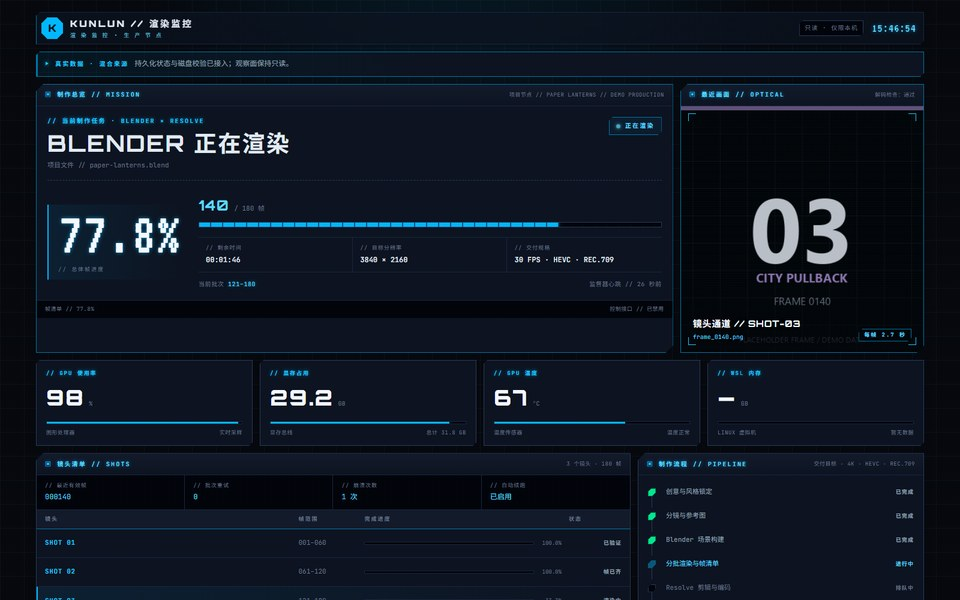
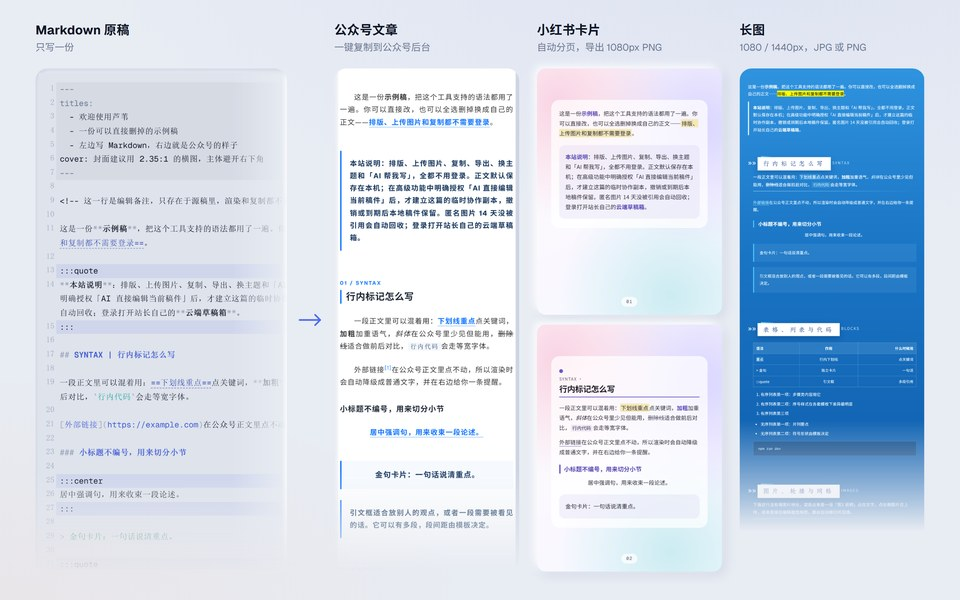
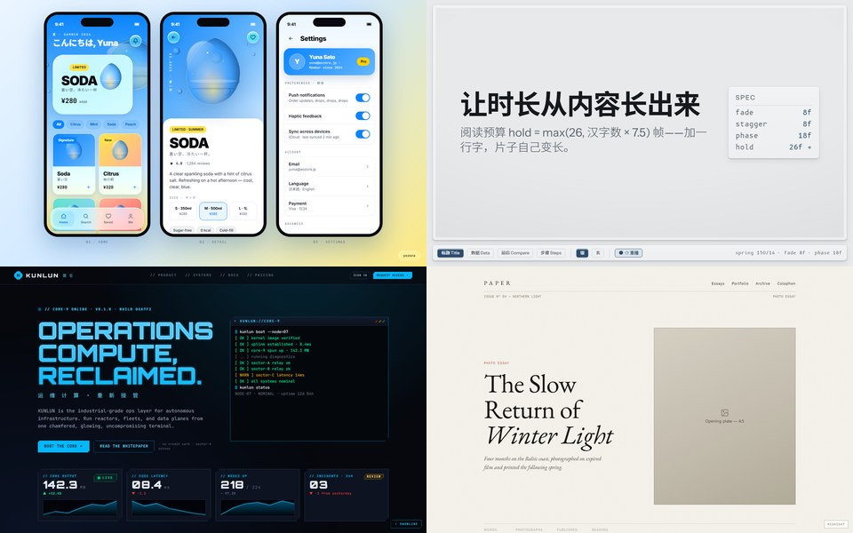
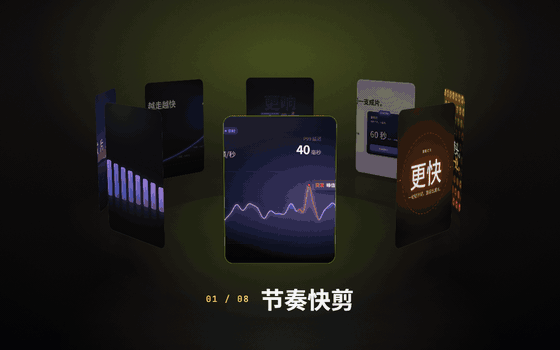

# yoru

*[English](README.md)*

底子是拍片的——相机、穿越机、达芬奇。现在一边做内容，一边给自己做创作用的 AI 工具：排版、视频流水线、agent 拿来就能用的设计系统；还有托住它们的 Agent 基础设施，必须经得住真实设备、真实工作流折腾：手机、手表、Windows。比起 demo 漂不漂亮，我更在意它部署以后、遇到真实用户和边界情况以后还成不成立。

### 精选作品

<table>
<tr>
<td width="50%"> <b>Blender Story Video</b> — 从一句创意到校验过的成片</td>
<td width="50%"> <b>芦苇 Reed</b> — 一份 Markdown，三种成品</td>
</tr>
<tr>
<td width="50%"> <b>Yoru Design Systems</b> — 九套 agent 拿来就能用的设计系统</td>
<td width="50%"> <b>达芬奇 OGraf 模板库</b> — 118 张动态图文卡，在检查器里改字改色</td>
</tr>
</table>

---

### 创作工具

**[Blender Story Video](https://github.com/yoruuuchan/create-blender-story-video)** — 一个 Agent Skill，从一句创意一路推到校验过的 4K 成片：锁定风格的分镜、Blender 制作、能从断点恢复的渲染、只读进度监控、Resolve 剪辑——帧数、编码、校验和全过才算交付。

**[达芬奇 OGraf 模板库](https://github.com/yoruuuchan/davinci-ograf-templates)** — 118 张给 DaVinci Resolve 21 的动态图文卡：标题、文字动效、图表、界面标注、转场。媒体池导入后在检查器里改字、改色、换字体，每张卡自带字体文件。[图鉴](https://github.com/yoruuuchan/davinci-ograf-templates/blob/main/CATALOG.md)。

**[芦苇](https://github.com/yoruuuchan/wechat-md-studio)** — 一份 Markdown 排出公众号文章、小红书卡片和长图，还能做公众号交互动效。AI 可以通过 MCP 改你正在写的那篇，但拿不走这份文档。227 套主题，3 套自己写的，224 套移植过来并保留作者与 License。[在线](https://wechat.yoru-and-akari.dev)。

**[Yoru Design Systems](https://github.com/yoruuuchan/yoru-design-systems)** — 九套各自独立的设计系统，每一套都是可安装的 Agent Skill：设计指南、CSS tokens、组件和样张卡，覆盖网页、视频、幻灯片与长内容。

**[Yoru Studio](https://github.com/yoruuuchan/yoru-studio-oss)** — 给独立创作者用的自托管执行台：项目、分镜、外拍、复盘、备份，以及通过 MCP 接入的 AI agent。

**[LyricLens](https://github.com/yoruuuchan/LyricLens)** — 边听歌边把歌词变成语言学习卡片。一个产品三个入口：网易云插件、独立 Windows 桌面版、手机复习 PWA，桌面端和手机之间端到端加密同步。

**[BGM 搜索关键词速查表](https://github.com/yoruuuchan/bgm-search-cheatsheet)** — 免费曲库的搜索黑话，覆盖 20 个视频场景。曲库标签标的是感觉不是用途：搜 `background music` 出来的是电子垃圾，搜 `soft ambient underscore` 才是能用的铺底。

### Agent 基础设施

**[Claude Desktop Kill-Switch](https://github.com/yoruuuchan/claude-desktop-killswitch)** — 代理一挂，Claude Desktop 12 秒内直连了 25 次。这组防火墙规则让它 fail-closed，README 也记录了六种看上去对但实际没解决问题的做法。

**[Akari Pulse](https://github.com/yoruuuchan/akari-pulse)** — vivo WATCH GT 的健康数据官方不让导，就自己逆。手表 RPK → 手机 APK → 自建数据库 → MCP。

**[Listening Bridge](https://github.com/yoruuuchan/listening-bridge)** — 把 Android / Windows 当前播放会话交给 AI：正在听什么、同步歌词上下文，以及通过 MCP 提供明确的播放控制。

**[chatgpt-mcp-connect](https://github.com/yoruuuchan/chatgpt-mcp-connect)** — 整理并验证把自定义 MCP server 接进 ChatGPT 的可行路径，覆盖直连和 runtime / aggregation 两类架构。

**[is-ai-down](https://github.com/yoruuuchan/is-ai-down)** — “是我这边的问题吗？”一个页面说清楚。状态 + 可达性探测，跑在 Cloudflare 上。[在线](https://is-ai-down.yoru-and-akari.dev)。

### 上游贡献

自己仓库以外的 7 个项目里，有 42 个已合并 PR。

- **[Operit](https://github.com/AAswordman/Operit)** — Android AI agent · [21 个已合并 PR](https://github.com/AAswordman/Operit/pulls?q=is%3Apr+author%3Ayoruuuchan+is%3Amerged)：模型 / Provider 接入、Tool Call 与历史消息正确性、Compose / DSL 状态与时序、崩溃和 UX 修复
- **[cli2api](https://github.com/caigee-cmd/cli2api)** — 面向编码 CLI 的多账号 API 代理 · [13 个已合并 PR](https://github.com/caigee-cmd/cli2api/pulls?q=is%3Apr+author%3Ayoruuuchan+is%3Amerged)：Provider 适配（含实验性的华为云 CodeArts 接入）、同 Provider 最早过期优先的账号调度、模型目录持久化（含 gpt-6.2 系列接入）、boot probe 失败后的 worker 恢复、流式 tool call 中保留工具名
- **零散的几个** — gzh-design-skill（公众号剪贴板序列化）、open-kimi-ppt-skill（浏览器启动与下载竞态，[#5](https://github.com/Binaryify/open-kimi-ppt-skill/pull/5) [#6](https://github.com/Binaryify/open-kimi-ppt-skill/pull/6)）、awesome-ai-companion、H440-FPV 机架

---

yoruandakari@duck.com
